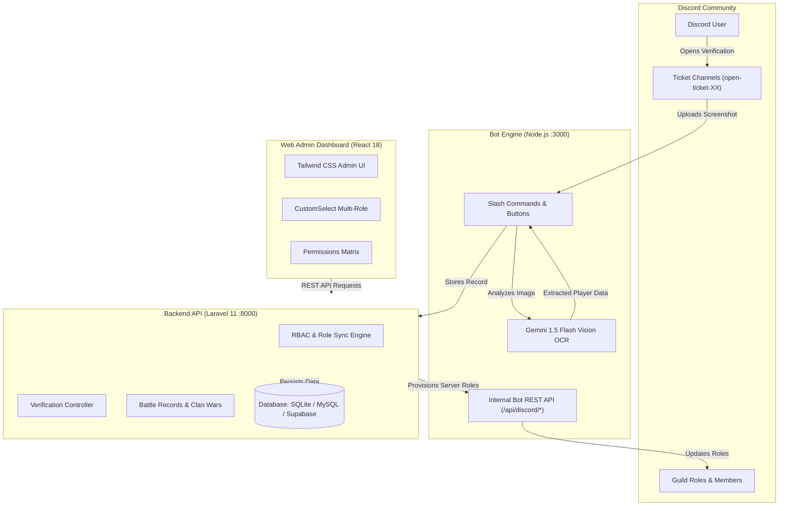

<div align="center">

# ⚡ Aries Modern Warships Management Ecosystem

### Automated Verification, Gemini Vision OCR, Unified Discord-Web RBAC & Clan Operations Platform

[](https://nodejs.org/)
[](https://discord.js.org/)
[](https://laravel.com/)
[](https://react.dev/)
[](https://tailwindcss.com/)
[](https://aistudio.google.com/)

[📖 Read the Documentation Hub](docs/README.md) · [🛠️ Quick Installation](docs/setup/INSTALLATION.md) · [🚀 Running Guide](docs/running/RUNNING_GUIDE.md) · [💾 Database Architecture](docs/database/DATABASE_GUIDE.md)

</div>

---

## 🌟 Executive Overview

**Aries Modern Warships Management Ecosystem** is an enterprise-grade platform specifically designed for Modern Warships competitive gaming clans and Discord gaming communities. 

It provides an end-to-end automated pipeline:
1. **Discord Bot Engine**: Automated verification ticketing, in-game screenshot processing via **Google Gemini 1.5 Flash Vision OCR**, post-match scoreboard extraction, war rosters, and transcript archiving.
2. **Backend API (Laravel 11)**: RESTful controllers, multi-driver database support (SQLite, MySQL, PostgreSQL/Supabase), Sanctum authentication, ship catalogs, and Discord REST synchronization.
3. **Admin Dashboard (React 18 + Vite + Tailwind CSS)**: Web administration dashboard featuring unified 1:1 Discord-to-Web RBAC, ticket review workflow, player management, battle record inspection, and dark mode.

---

## 🚀 Key Capabilities

* 🎫 **Automated Verification Tickets**: Members click a button in `#welcome` to generate private `open-ticket-XX` channels with automatic numbering and permission isolation.
* 👁️ **Multi-Modal OCR Vision**: Uses Google Gemini 1.5 Flash Vision to extract player IGNs (preserving Unicode symbols like `Ψ`, `Ω`, `⚡`), Account IDs, and Player Levels, with fallback to Google Cloud Vision and OCR.space.
* 🛡️ **Unified 1:1 RBAC (Discord Role = Web Role)**: Discord roles directly map to web permissions. Assigning multiple roles on the web automatically synchronizes them to the member in Discord in real-time.
* ⚔️ **Clan Wars & Battle Records**: Extracts scoreboard statistics (damage dealt, kills, ship types used, victory/defeat) directly into player profiles and season leaderboards.
* 📝 **Transcript Generation**: Saves formatted HTML and JSON transcripts of closed ticket discussions for accountability and audit trails.
* ⚡ **Zero-Dependency `CustomSelect`**: A lightweight multi-select dropdown component featuring tag chips, checkboxes, instant search, and smart modal collision detection.
* 💾 **Multi-Driver Database Support**: Plug-and-play local development with SQLite, or high-concurrency cloud production with MySQL or Supabase/PostgreSQL.

---

## 🏛️ System Architecture



---

## 📁 Repository Directory Layout

```
discord-bot-aries/
├── src/                               # Discord Bot Engine (Node.js)
│   ├── config/                        # Bot config & ship data dictionaries
│   ├── handlers/                      # Slash commands, button interactions & messages
│   ├── services/                      # OCR (Gemini/Cloud Vision), RBAC, battle records
│   ├── utils/                         # Rate limiting, logger & input sanitizers
│   └── index.js                       # Bot entrypoint & internal HTTP server (:3000)
│
├── mw-api/                            # Backend REST API (Laravel 11)
│   ├── app/Http/Controllers/Api/      # REST Controllers (RBAC, Tickets, Wars, Ships)
│   ├── app/Models/                    # Eloquent Models & relationships
│   ├── database/migrations/           # Agnostic database migrations
│   ├── database/seeders/              # Ships, RBAC permissions, and backup seeders
│   └── routes/api.php                 # API route definitions
│
├── mw-verification-admin/             # Admin Web Dashboard (React 18 + Vite + Tailwind)
│   ├── src/components/ui/select/      # Lightweight CustomSelect component
│   ├── src/layout/                    # Dashboard Layout, Sidebar & Header
│   ├── src/pages/                     # Roles, Tickets, Members, Wars, Ships, Transcripts
│   └── vite.config.ts                 # Builds directly to ../mw-api/public/
│
├── docs/                              # Comprehensive Documentation Hub
│   ├── setup/                         # Prerequisites, Installation, Env Variables, Discord Setup
│   ├── running/                       # Running Guide, PM2 Management, Troubleshooting
│   ├── database/                      # Architecture, Schema Reference, Migrations
│   ├── architecture/                  # System Design, RBAC Model, OCR Pipeline
│   └── specifications/                # BRD, PRD, and SRS documents
│
├── data/                              # Local JSON cache & offline database fallback
├── schema.sql                         # PostgreSQL / Supabase base schema
├── schema_v2.sql                      # Clan management & RBAC schema
├── schema_battle_records.sql          # Battle telemetry schema
├── schema_rank_history.sql            # Clan rank history schema
└── package.json                       # Bot dependencies and npm scripts
```

---

## ⚡ Quick Start (5 Minutes)

### 1. Prerequisites
Make sure you have installed:
- **Node.js**: `v18.0.0` or higher (Node 20+ LTS recommended)
- **PHP**: `8.2.0` or higher with `pdo_sqlite`, `curl`, and `mbstring` extensions
- **Composer**: `v2.5.0` or higher

*(For full operating system requirements, see [PREREQUISITES.md](docs/setup/PREREQUISITES.md).)*

---

### 2. Setup Bot & Dependencies

```bash
# 1. Clone repository
git clone https://github.com/jhustinn/discord-bot-aries.git
cd discord-bot-aries

# 2. Install Bot dependencies
npm install

# 3. Configure Bot environment
cp .env.example .env
# Edit .env with your DISCORD_TOKEN, GUILD_ID, and GEMINI_API_KEY
```

---

### 3. Setup Laravel Backend API

```bash
cd mw-api

# 1. Install PHP dependencies
composer install

# 2. Setup environment & application key
cp .env.example .env
php artisan key:generate

# 3. Run database migrations and seeders (SQLite default)
php artisan migrate --seed
```

---

### 4. Setup React Admin Dashboard

```bash
cd ../mw-verification-admin

# 1. Install frontend dependencies
npm install

# 2. Setup frontend environment
cp .env.example .env

# 3. Build production assets to Laravel public directory
npm run build
```

---

## 🏃 Running the Services

### Option A: Development Mode (3 Independent Terminals)

* **Terminal 1 (Discord Bot)**:
  ```bash
  npm start
  # Bot runs on port 3000
  ```

* **Terminal 2 (Laravel API)**:
  ```bash
  cd mw-api
  php artisan serve --port=8000 --no-reload
  ```

* **Terminal 3 (Admin Dashboard Dev Server)**:
  ```bash
  cd mw-verification-admin
  npm run dev
  # Admin UI available at http://localhost:5173
  ```

### Option B: Production Single-Port Deployment
After running `npm run build` in `mw-verification-admin`, the React application is served directly by Laravel:
* **Admin Dashboard & API**: `http://localhost:8000/`
* **Bot Service**: Background via PM2 or systemd (`npm start`)

*(For full production process supervisor configs, see [PROCESS_MANAGEMENT.md](docs/running/PROCESS_MANAGEMENT.md).)*

---

## 🤖 Discord Slash Commands

| Command | Permission | Description |
| :--- | :--- | :--- |
| `/verify-panel` | Administrator | Spawns the verification panel embed with the interactive "Verifikasi Akun" button. |
| `/verify-approve` | Staff / Admin | Approves a ticket, grants the Discord verified role, and archives the channel. |
| `/verify-reject` | Staff / Admin | Rejects a ticket with an optional reason. |
| `/verify-close` | Staff / Admin | Closes and locks the ticket channel, preventing further messages. |
| `/stats` | Everyone | Displays server verification metrics and statistics. |
| `/clan-register` | Verified Member | Registers player into the clan war availability roster. |
| `/score-record` | Verified Member | Uploads post-match screenshot for OCR damage & kill extraction. |

---

## 📚 Complete Documentation Index

All technical documentation is organized in the [`docs/`](docs/) directory:

* 🛠️ **Setup & Configuration**
  * [System Prerequisites](docs/setup/PREREQUISITES.md)
  * [Installation Guide](docs/setup/INSTALLATION.md)
  * [Environment Variables Reference](docs/setup/ENVIRONMENT_VARIABLES.md)
  * [Discord Bot & Intents Setup](docs/setup/DISCORD_SETUP.md)
* 🚀 **Running & Operations**
  * [Running Guide](docs/running/RUNNING_GUIDE.md)
  * [Production Process Management (PM2 & systemd)](docs/running/PROCESS_MANAGEMENT.md)
  * [Troubleshooting Guide](docs/running/TROUBLESHOOTING.md)
* 💾 **Database & Schemas**
  * [Database Architecture Guide](docs/database/DATABASE_GUIDE.md)
  * [Schema Reference & Data Dictionary](docs/database/SCHEMA_REFERENCE.md)
  * [Migrations & Seeders Guide](docs/database/MIGRATIONS_AND_SEEDERS.md)
* 🏛️ **System Architecture**
  * [Tri-Tier Architecture & Data Flow](docs/architecture/ARCHITECTURE.md)
  * [Unified 1:1 RBAC System](docs/architecture/RBAC_SYSTEM.md)
  * [Dual-Engine OCR Pipeline](docs/architecture/OCR_PIPELINE.md)
* 📄 **Product Specifications**
  * [Business Requirements Document (BRD)](docs/specifications/BRD.md)
  * [Product Requirements Document (PRD)](docs/specifications/PRD.md)
  * [Software Requirements Specification (SRS)](docs/specifications/SRS.md)

---

## 📄 License & Attribution

This project is licensed under the [MIT License](LICENSE). Built for the Modern Warships community.
All Modern Warships game assets, ship names, and artwork are property of Artstorm FZE.
