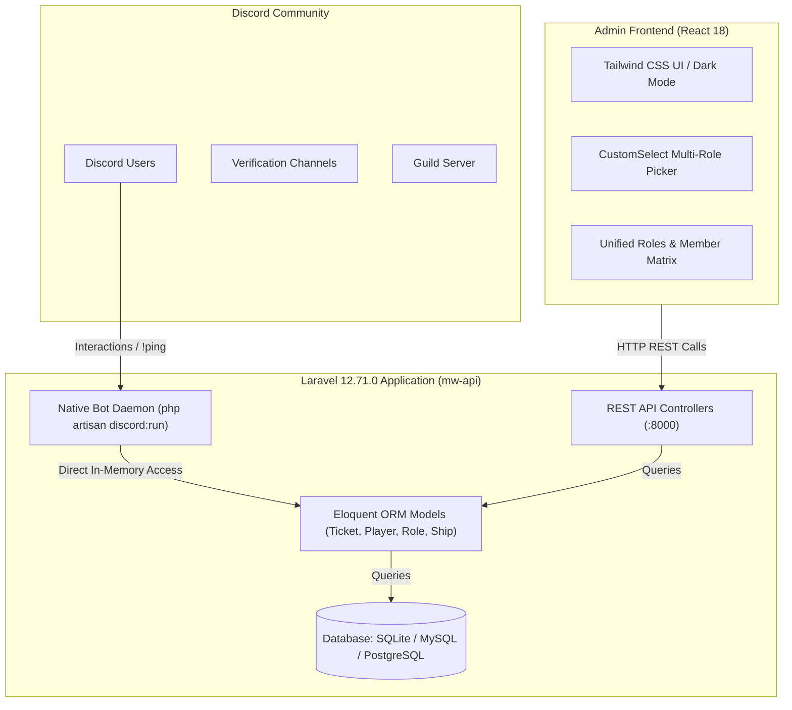
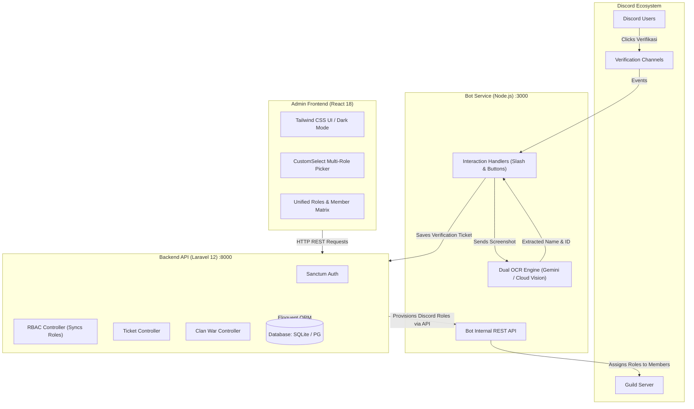
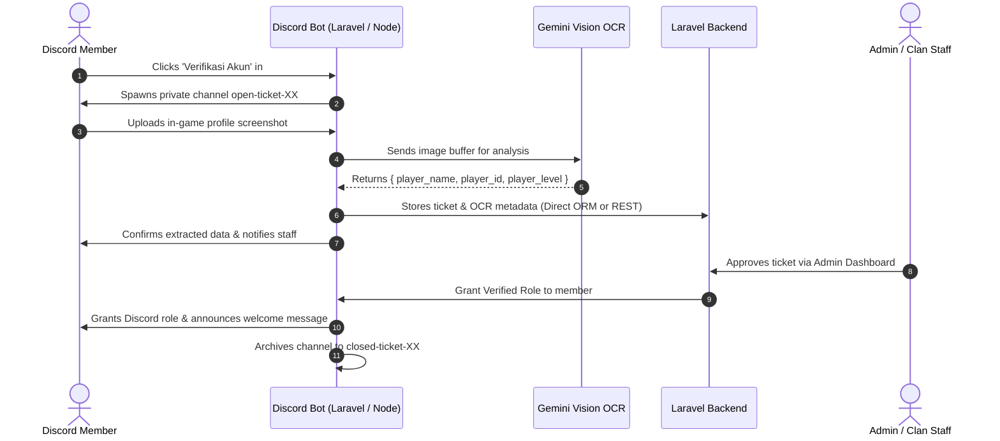

# 🏛️ System Architecture

This document outlines the high-level architecture, design patterns, and cross-service communication flows of the Aries Modern Warships Platform.

---

## 📐 Dual-Engine Architecture: Full Laravel vs Hybrid Node.js

The ecosystem supports two operational modes:

### Mode 1: Full Laravel Monolith (Zero-Node.js Backend)



In this architecture:
- Both the Discord Bot and the REST API live inside **Laravel 12.71.0**.
- The bot accesses Eloquent models directly in PHP without HTTP networking overhead or JSON serialization.
- Server maintenance is simplified: you only need PHP 8.2+ and Composer.

---

### Mode 2: Hybrid Stack (Node.js Bot + Laravel API)



---

## 🔄 Verification & Auto-OCR Sequence



---

## ⚡ Internal API Bridge Authentication (Hybrid Mode)

When running in Hybrid Mode, the Discord Bot exposes a local REST API on `http://localhost:3000/api/discord/*` allowing Laravel to inspect guild channels, read live server roles, fetch server members, and modify member roles.

All requests between Laravel and the Bot require an authentication header:
```http
x-api-key: aries-admin-2024
```
If the header is missing or does not match `API_SECRET_KEY`, the request is rejected with `401 Unauthorized`.
In Full Laravel mode, this HTTP bridge is bypassed because the bot has direct internal access to the models and gateway.
