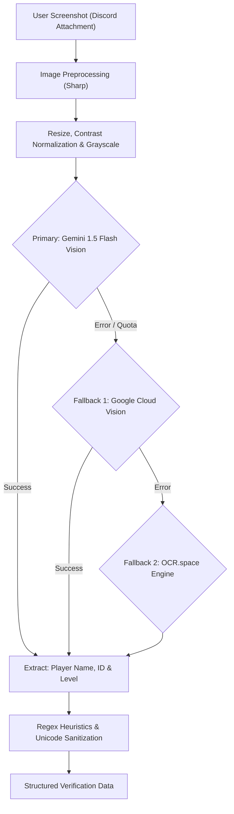

# 👁️ Dual-Engine OCR Pipeline

Modern Warships screenshots pose unique computer vision challenges: custom game fonts, stylized symbols, Cyrillic/Greek/Japanese characters, and variable screen resolutions across mobile devices.

This document details how the Aries OCR pipeline reliably extracts player identities and battle scoreboards.

---

## ⚙️ OCR Engine Architecture

---

## 1. Google Gemini 1.5 Flash Vision (Default)
Implemented in [`src/services/ocr-gemini.js`](../../src/services/ocr-gemini.js).

### Advantages:
- **Free & No Credit Card Required**: Accessible via Google AI Studio.
- **Superior Multimodal Recognition**: Understands complex game UI layouts, distinct avatar borders, and decorative clan brackets (e.g. `[ARIES]`, `『MW』`).
- **Full Unicode Fidelity**: Preserves special characters such as `Ψ`, `Ω`, `⚡`, `👑`, `亗`, and non-Latin scripts without corruption.

---

## 2. Google Cloud Vision API (Fallback 1)
Implemented in [`src/services/ocr.js`](../../src/services/ocr.js).
- Enterprise OCR model supporting high-resolution image analysis and text annotations.
- Activated when `GOOGLE_CREDENTIALS` is present in `.env`.

---

## 3. Scoreboard Match Extraction
Implemented in [`src/services/scoreboardOcr.js`](../../src/services/scoreboardOcr.js).
Extracts post-battle telemetry:
- Victory vs. Defeat detection.
- Total player damage output.
- Kills count.
- Deployed ship model recognition against known ships catalog in `src/config/ships.js`.
