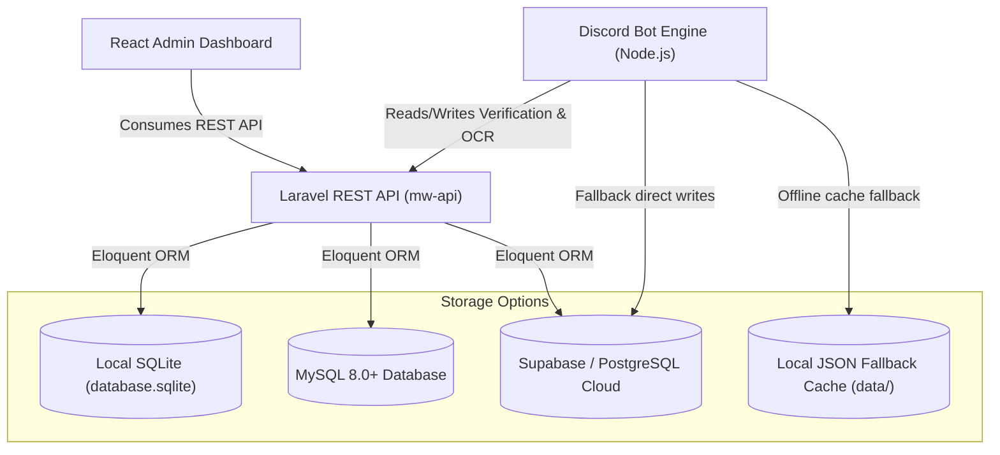

# 💾 Database Architecture & Multi-Driver Guide

The Aries Modern Warships management platform is engineered with a flexible database layer that supports multiple database engines:
1. **SQLite (Default & Local Development)**: Zero external service setup required. Plug-and-play.
2. **Supabase / PostgreSQL (Cloud Production)**: Relational scalability with row-level security, realtime events, and S3-compatible asset storage.
3. **MySQL / MariaDB (Standard Relational)**: For standard self-hosted Linux VPS deployments.

---

## 🏗️ Architectural Overview & Dual-Store Sync



---

## 🔧 Configuring Database Drivers in `mw-api/.env`

### Option 1: SQLite (Default)
Ideal for small-to-medium servers, local testing, and development.
```env
DB_CONNECTION=sqlite
DB_DATABASE=/absolute/path/to/discord-bot-aries/mw-api/database/database.sqlite
```
*Or relative path:* `DB_DATABASE=database/database.sqlite`

### Option 2: MySQL / MariaDB
```env
DB_CONNECTION=mysql
DB_HOST=127.0.0.1
DB_PORT=3306
DB_DATABASE=aries_clan_db
DB_USERNAME=aries_user
DB_PASSWORD=your_secure_password
```

### Option 3: PostgreSQL / Supabase
```env
DB_CONNECTION=pgsql
DB_HOST=db.your-project.supabase.co
DB_PORT=5432
DB_DATABASE=postgres
DB_USERNAME=postgres
DB_PASSWORD=your_supabase_db_password
```

---

## 🗄️ Database Schemas Included

The repository contains both raw SQL schema definitions and structured Laravel migrations:

| File | Engine | Purpose |
| :--- | :--- | :--- |
| `schema.sql` | PostgreSQL / Supabase | Original v1 ticket verification tables. |
| `schema_v2.sql` | PostgreSQL / Supabase | Full v2 clan system: teams, wars, points, seasons, and RBAC tables. |
| `schema_battle_records.sql` | PostgreSQL / SQLite / MySQL | Modern Warships battle record logs, victory/defeat, kills, damage, and ship types. |
| `schema_rank_history.sql` | PostgreSQL / SQLite / MySQL | Historical clan rank promotions, demotions, and points ledger. |
| `mw-api/database/migrations/*` | Laravel Eloquent (Agnostic) | Production migrations that run smoothly across SQLite, MySQL, and PostgreSQL. |

---

## 🛡️ Offline Resiliency & Fallback Layer (`data/`)

When Supabase or an external database is unreachable, the Discord bot seamlessly falls back to storing data locally in JSON format under the `data/` directory:
- `data/verification_tickets.json`
- `data/verified_players.json`
- `data/battle_records.json`
- `data/clan_wars.json`
- `data/rbac_permissions.json`
- `data/rbac_user_roles.json`

This ensures that Discord users are **never blocked** from submitting verification tickets or registering for clan wars during database outages.
