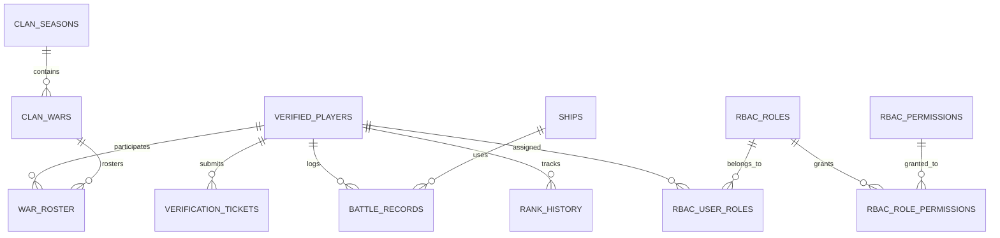

# 📑 Database Schema Reference & Data Dictionary

This document details all core database tables, primary keys, foreign relations, column datatypes, and descriptions.

---

## 🗂️ Entity Relationship Diagram (ERD)

---

## 1. Table: `verified_players`
Stores registered and verified Modern Warships players.

| Column | Type | Constraints | Description |
| :--- | :--- | :--- | :--- |
| `id` | `uuid` / `string` | PRIMARY KEY | Unique player internal UUID. |
| `discord_user_id` | `string(64)` | UNIQUE, NOT NULL | Discord Snowflake ID of the user. |
| `discord_username` | `string(255)`| NOT NULL | Discord handle (e.g. `jhustinn`). |
| `player_id` | `string(64)` | UNIQUE, NOT NULL | Modern Warships In-Game Account ID (Numbers). |
| `player_name` | `string(255)`| NOT NULL | Modern Warships in-game name (supports Unicode/emojis). |
| `player_level` | `integer` | DEFAULT 1 | Player account level. |
| `clan_tag` | `string(32)` | NULLABLE | Clan affiliation tag (e.g. `[ARIES]`). |
| `status` | `string(32)` | DEFAULT 'active'| Player status (`active`, `banned`, `inactive`). |
| `verified_at` | `timestamp` | NOT NULL | Timestamp when verification was approved. |
| `created_at` | `timestamp` | - | Record creation timestamp. |
| `updated_at` | `timestamp` | - | Last modification timestamp. |

---

## 2. Table: `verification_tickets`
Tracks verification ticket lifecycles opened via Discord `/verify-panel`.

| Column | Type | Constraints | Description |
| :--- | :--- | :--- | :--- |
| `id` | `uuid` / `string` | PRIMARY KEY | Unique ticket UUID. |
| `ticket_number` | `integer` | NOT NULL | Incremental ticket sequence number (1, 2, 3...). |
| `channel_id` | `string(64)` | NOT NULL | Discord text channel ID (`open-ticket-XX`). |
| `discord_user_id` | `string(64)` | NOT NULL | User who initiated the verification ticket. |
| `status` | `string(32)` | NOT NULL | `open`, `pending_approval`, `approved`, `rejected`, `closed`. |
| `ocr_status` | `string(32)` | DEFAULT 'pending' | OCR extraction status (`success`, `failed`, `manual`). |
| `extracted_player_id` | `string(64)` | NULLABLE | ID parsed from screenshot via OCR. |
| `extracted_player_name`| `string(255)`| NULLABLE | Name parsed from screenshot via OCR. |
| `extracted_level` | `integer` | NULLABLE | Level parsed from screenshot via OCR. |
| `screenshot_url` | `text` | NULLABLE | URL or relative path to uploaded profile screenshot. |
| `reviewed_by` | `string(64)` | NULLABLE | Discord user ID of staff who reviewed ticket. |
| `rejection_reason`| `text` | NULLABLE | Reason given if ticket was rejected. |
| `transcript` | `text` / `json` | NULLABLE | Full archived message transcript of the ticket channel. |
| `created_at` | `timestamp` | - | Ticket opening timestamp. |
| `closed_at` | `timestamp` | NULLABLE | Ticket closure timestamp. |

---

## 3. Table: `battle_records`
Stores individual Modern Warships battle statistics extracted from post-match scoreboards.

| Column | Type | Constraints | Description |
| :--- | :--- | :--- | :--- |
| `id` | `uuid` / `string` | PRIMARY KEY | Unique battle record UUID. |
| `discord_user_id` | `string(64)` | NOT NULL | Player who submitted the battle record. |
| `player_id` | `string(64)` | NOT NULL | Modern Warships account ID. |
| `match_type` | `string(32)` | DEFAULT 'clan_war' | Match type (`clan_war`, `scrim`, `ranked`, `custom`). |
| `result` | `string(16)` | NOT NULL | `victory` or `defeat`. |
| `damage_dealt` | `bigint` | DEFAULT 0 | Total combat damage inflicted. |
| `kills` | `integer` | DEFAULT 0 | Confirmed enemy ships destroyed. |
| `ship_name` | `string(128)`| NULLABLE | Ship model used (e.g. `RF Moscow`, `USS Gerald R. Ford`). |
| `screenshot_url` | `text` | NULLABLE | Proof screenshot attachment. |
| `verified_by` | `string(64)` | NULLABLE | Staff member who verified match record. |
| `created_at` | `timestamp` | - | Date and time match occurred. |

---

## 4. Tables: Role-Based Access Control (`rbac_*`)

### `rbac_roles`
Unified Discord Server and Web Application Roles.
- `role_id` (PK): UUID string.
- `role_name`: Display name (e.g. `Super Admin`, `Clan Leader`, `Verified Member`).
- `role_slug`: Unique slug (e.g. `superadmin`, `clan_leader`).
- `discord_role_id`: Linked Discord Role Snowflake ID (1:1 sync).
- `color`: Hex color string (e.g. `#DC2626`).
- `icon`: Unicode emoji icon (e.g. `👑`, `🛡️`).
- `is_system`: Boolean (prevents critical roles from deletion).

### `rbac_permissions`
Granular application capabilities.
- `permission_id` (PK): UUID string.
- `permission_slug`: Unique slug (e.g. `tickets.approve`, `wars.manage`, `rbac.assign`).
- `category`: Grouping (e.g. `Tickets`, `Members`, `Wars`, `RBAC`, `Settings`).

### `rbac_role_permissions`
Many-to-many pivot mapping permissions to roles.

### `rbac_user_roles`
Multi-role assignment linking `user_id` (Discord Snowflake ID) to `role_id`.

---

## 5. Table: `ships`
Catalog of Modern Warships naval vessels for accurate stats tracking.
- `id` (PK): UUID string.
- `name`: Ship name (e.g. `USS Missouri (BB-63)`).
- `tier`: Tier rank (`Tier I`, `Tier II`, `Tier III`).
- `type`: Ship class (`Destroyer`, `Cruiser`, `Battleship`, `Aircraft Carrier`, `Submarine`).
- `country`: Country flag / origin (e.g. `USA`, `Russia`, `Japan`).
